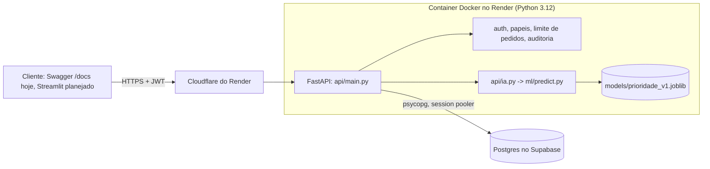

# Rede Alimenta IA

Projeto integrador de Ciberseguranca e DevSecOps (FIAP, Tecnologo em Inteligencia Artificial). A API cadastra lotes de alimentos doados, classifica a prioridade de descarte com um modelo de IA e registra a doacao do lote para uma ONG. O matching automatico por necessidade, capacidade e distancia esta planejado e ainda nao existe (ver "O que ainda nao esta no repo").

API publica: https://rede-alimenta-ia-api.onrender.com (Swagger em `/docs`). O servico esta no plano free e dorme sem trafego; ver "Producao".

## Equipe

- Charles Augusto Miranda da Silva: IA e Dados
- Rafael Fernandes de Paula Goncalves: Backend, Banco e Deploy
- Gustavo Reatti Sela: Interface e Dashboard
- Anthony Prado Pereira: DevSecOps e Seguranca

Orientacao: Prof. M.Sc Oerton Fernandes.

## Arquitetura



Um `POST /lotes` passa por: limite de pedidos, conferencia do token e do papel, validacao do corpo, modelo de IA (que devolve `tipo` e `prioridade`), gravacao no banco e uma linha de auditoria no stdout.

| Parte | Onde | O que faz |
|---|---|---|
| API | `api/` | FastAPI com rotas de doadores, ONGs, lotes, doacoes, usuarios, KPIs e login |
| Seguranca | `api/seguranca.py`, `limites.py`, `auditoria.py`, `erros.py` | JWT, papeis admin/doador/ong, senhas com argon2, limites, log em JSON, erros sem stack trace |
| Modelo | `ml/`, `models/` | Classifica a categoria do alimento e a prioridade (alta, media, baixa). O artefato `.joblib` vai versionado no repo e na imagem |
| Armazenamento | `api/storage.py`, `infra/db/schema.sql` | Em memoria (testes e dev rapido) ou Postgres/Supabase, escolhido por `STORAGE` |
| Deploy | `api/Dockerfile`, `render.yaml` | Imagem sem root, publicada no Render |

Tabelas: `doadores`, `ongs`, `lotes`, `doacoes`, `usuarios` e `demo_seed` (copia do seed da demo). Todas com RLS ligado e sem policy: a API REST do Supabase nao le nada, so a nossa API, que conecta como dono das tabelas.

## Estrutura do repositorio

- `api/`: backend FastAPI, testes em `api/tests/`
- `ml/`: modelo de priorizacao e testes
- `models/`: modelo treinado e `metrics.json`
- `app/`: reservado ao frontend (hoje so `.gitkeep`)
- `infra/`: schema do banco, scripts de banco e o hello world do deploy de teste
- `docs/`: decisoes tecnicas, checkpoints, auth, deploy, container e relatorios de seguranca
- `data/`: dataset simulado, gerador e `seed_demo.json`

## Como rodar

### Local

Precisa de Python 3.11 ou mais (o scikit-learn 1.8 do modelo nao instala no 3.10).

```
python -m venv .venv
.venv\Scripts\activate          # Windows; no Linux/Mac: source .venv/bin/activate
pip install -r api/requirements-dev.txt
copy .env.example .env          # no Linux/Mac: cp .env.example .env
```

Edite o `.env`: gere o `JWT_SECRET` com `python -c "import secrets; print(secrets.token_urlsafe(48))"` (minimo 32 caracteres) e preencha `ADMIN_EMAIL` e `ADMIN_PASSWORD` (10 ou mais caracteres). O admin e criado na primeira subida. Depois:

```
uvicorn api.main:app --reload
```

Swagger em http://localhost:8000/docs e health check em `/health`. Sem `JWT_SECRET` a API nao sobe.

Por padrao a API guarda tudo em memoria e perde os dados quando reinicia. Pra usar o banco, ponha `STORAGE=postgres` e `SUPABASE_DB_URL` no `.env` e crie as tabelas uma vez com `python infra/db/aplicar_schema.py` (pode repetir sem problema). `GET /health/db` mostra qual storage esta ativo e, no Postgres, testa a conexao.

Pra ter dados de exemplo com a API de pe, `python -m api.seed_dev` cadastra um doador e uma ONG (nao duplica se ja houver doador). O fluxo completo da demo em memoria, sem subir a API, roda com `python -m api.demo_checkpoint`.

### Docker

Da raiz do repo:

```
docker build -t rede-alimenta-api -f api/Dockerfile .
docker run -d --name rede-api -p 8000:8000 \
  -e STORAGE=postgres -e SUPABASE_DB_URL -e JWT_SECRET -e ADMIN_EMAIL -e ADMIN_PASSWORD \
  rede-alimenta-api
```

`-e VAR` sem valor copia a variavel do shell, entao a senha do banco nao aparece no comando. Sem `STORAGE=postgres` a API sobe em memoria. A imagem usa Python 3.12, roda com um usuario sem root e traz um healthcheck em `/health`. O `.dockerignore` deixa o `.env` de fora.

Nao existe `docker-compose.yml`: so a imagem da API foi testada. Medidas, o que foi e o que nao foi testado em `docs/container.md`; achados do Trivy em `docs/security/trivy-imagem.md`.

### Producao

A API roda no Render (plano free, regiao Ohio, a mesma do Supabase), criada pelo Blueprint do `render.yaml` a partir da `main`. O deploy automatico esta desligado (`autoDeployTrigger: "off"`): publicar e uma acao manual no painel do Render.

1. New > Blueprint, apontando pro repo, branch `main`.
2. Preencher `SUPABASE_DB_URL`, `ADMIN_EMAIL` e `ADMIN_PASSWORD`. Na primeira vez o Render nao perguntou e o servico subiu sem elas: `/health` deu 200 mas o login dava 500. Depois de qualquer deploy, confira na aba Environment que as tres continuam la. `/health` sozinho nao prova que o banco esta ligado, use `/health/db`.
3. Aplicar o schema no Supabase com `python infra/db/aplicar_schema.py`.
4. Conferir com `python -m infra.db.testar_producao`, que roda o fluxo ponta a ponta contra a URL publica e apaga o que criou.

Antes de uma apresentacao: o servico dorme depois de uns 15 minutos sem trafego e o primeiro pedido leva cerca de 22 s (medido uma vez). O primeiro `POST /lotes` leva mais uns 10 s porque carrega o modelo. Abra `/health` uns 5 minutos antes e faca um `POST /lotes` de aquecimento. Detalhes, riscos e o plano B em `docs/deploy-render.md`.

## Variaveis de ambiente

A lista completa, com placeholders, esta em `.env.example`. O `.env` fica fora do git. No Render elas entram pelo painel ou pelo `render.yaml`; nunca vao pra imagem.

| Variavel | Padrao | Pra que serve |
|---|---|---|
| `STORAGE` | `memory` | `memory` ou `postgres`. Em producao tem que ser `postgres`; em memoria a API sobe sem reclamar e perde tudo a cada deploy |
| `SUPABASE_DB_URL` | sem padrao | Conexao do Supabase (session pooler, IPv4). Obrigatoria com `STORAGE=postgres` e nos scripts de `infra/db/`. Senha com caractere especial precisa de percent-encode |
| `JWT_SECRET` | sem padrao | Assina os tokens. Minimo 32 caracteres; sem ele a API nao sobe. No Render e gerado pelo Blueprint |
| `TOKEN_MINUTOS` | `30` | Validade do token |
| `ADMIN_EMAIL`, `ADMIN_PASSWORD` | vazios | Admin criado na subida se o e-mail ainda nao existir. Sem as duas a API nao cria admin |
| `MAX_BODY_BYTES` | `65536` | Maior corpo de pedido aceito (acima disso volta 413) |
| `CONFIAR_CF_CONNECTING_IP` | desligada | Com `1`, o IP do cliente (limite de pedidos e log) vem do `CF-Connecting-IP`. Ligar so no Render: fora de um proxy que sobrescreva o cabecalho, qualquer cliente forja o IP |
| `KG_POR_REFEICAO` | `0.5` | Fator dos KPIs de impacto. Premissa do grupo, sem fonte ainda (`docs/kpis.md`) |
| `PORT` | `8000` | So no `render.yaml`, pra bater com a porta do Dockerfile |
| `API_URL` | `http://localhost:8000` | So nos scripts que falam com a API por HTTP (`api/seed_dev.py`, `infra/db/testar_login.py`, `infra/db/testar_producao.py`) |
| `MONGODB_URI` | sem padrao | So pro `infra/db/test_connections.py` (comparacao de bancos do dia 3). A API nao usa |

## Reset da demo

`infra/db/reset_demo.py` devolve o banco em nuvem ao estado inicial da demo. O seed fica em `data/seed_demo.json`: 3 doadores, 4 ONGs e 5 lotes, todos marcados `(DEMO)` e simulados. A validade dos lotes e contada em dias a partir do dia do reset, entao nenhum lote nasce vencido. O arquivo foi escrito pelo Rafael pra destravar o script; o seed do Charles nao chegou ao repo e pode substitui-lo.

```
python -m infra.db.reset_demo backup             # guarda o seed na tabela demo_seed
python -m infra.db.reset_demo reset              # so mostra o que seria apagado
python -m infra.db.reset_demo reset --aplicar    # apaga e recarrega o seed
python -m infra.db.reset_demo reset --aplicar --seed-do-banco   # usa a copia do banco
```

O reset apaga doacoes, lotes, doadores, ONGs e usuarios que nao sejam admin, zera os ids (o primeiro lote volta a ser o 1) e recarrega o seed pelas mesmas regras da API, com a prioridade vinda do modelo. Os admins ficam. Tudo roda numa transacao. Antes de apagar, as linhas que existiam vao pra `backups/` (fora do git, sem o hash das senhas). A tabela `demo_seed` vem do `schema.sql`, entao rode `aplicar_schema.py` antes do primeiro `backup`.

Nao rode `api.fluxo_http` contra a URL publica: ele cria doacoes, que nao tem DELETE na API e ficam no banco de producao. Se rodar, o reset limpa.

## Testes e qualidade

```
pytest api        # sempre em memoria, nunca toca o banco
pytest ml
ruff check .
```

Em 12/10: 368 testes em `api` e 47 em `ml`, todos passando, e o ruff sem achados. O fluxo em producao tem seu proprio script (`infra.db.testar_producao`, 17 verificacoes no dia 23). Nao ha pipeline de CI no repo.

## Referencia da API

### Autenticacao e papeis

Todo endpoint, menos `/health`, `/docs` e `POST /auth/login`, pede token. Decisoes em `docs/auth.md`.

1. `POST /auth/login` com `{"email": ..., "senha": ...}` devolve `access_token` (JWT, vale 30 min). Erro de login volta 401 sempre com a mesma mensagem; 5 erros no mesmo e-mail em 15 min voltam 429 com `Retry-After`.
2. Nas demais chamadas: `Authorization: Bearer <token>`. No Swagger, botao "Authorize".
3. Quem cria usuario e o admin (`POST /usuarios`); nao existe cadastro aberto.

| Papel | Pode |
|---|---|
| `admin` | tudo |
| `doador` | ler e editar o proprio cadastro; criar, ver, editar e apagar os proprios lotes; confirmar doacao dos proprios lotes; listar as ONGs |
| `ong` | listar as ONGs e editar a propria; ver os lotes e doacoes que recebeu |

Sem token valido volta 401; papel ou dono errado volta 403. A matriz completa esta em `api/tests/test_acesso_negado.py`.

### Lote: contrato

O frontend le a URL da API da variavel `API_URL` (padrao `http://localhost:8000`). Fluxo: `POST /lotes` e depois `GET /lotes`.

```json
{
  "doador_id": 1,
  "descricao": "alface",
  "quantidade_kg": 12.5,
  "validade": "2026-10-01",
  "armazenamento": "refrigerado"
}
```

`armazenamento` aceita `ambiente`, `refrigerado` ou `congelado`. `quantidade_kg` tem que ser maior que zero e `descricao` nao pode ser vazia (422 caso contrario). `status`, `prioridade` e `id` voltam preenchidos pela API; o cliente nao consegue setar `prioridade`.

### Doador

- `documento` aceita com ou sem mascara, mas precisa ter 11 digitos (`fisica`) ou 14 (`juridica`); a API guarda so os digitos. Nao valida digito verificador.
- `estado` e a sigla com 2 letras (vira maiuscula). `email`, se vier, precisa ter formato de e-mail. Latitude entre -90 e 90, longitude entre -180 e 180.
- `PUT /doadores/{id}` e atualizacao parcial; documento e tipo de pessoa nao mudam.
- 201 criou, 204 apagou, 404 nao achou, 409 documento repetido ou doador com lotes, 422 dado invalido.

### ONG e lote: regras

ONG:
- `cnpj` com ou sem mascara, 14 digitos, guardado sem mascara. CNPJ repetido volta 409. Nao muda depois de criada.
- `capacidade_kg` entre 0 e 100000. `necessidades` vira minuscula, sem repetido e sem vazio, e so aceita as 6 categorias do modelo (`hortifruti`, `padaria`, `laticinios`, `carnes_peixes`, `preparados`, `nao_pereciveis`); outra volta 422.

Lote:
- Nao aceita `validade` anterior a hoje nem mais de 730 dias a frente (422), nem `quantidade_kg` acima de 5000. A checagem e so na entrada. Os tetos sao premissa do dia 20 (`docs/decisoes.md`).
- `GET /lotes` aceita `?status=` e `?doador_id=`.
- Status so anda assim: `disponivel` -> `reservado` ou `descartado`; `reservado` -> `disponivel`, `doado` ou `descartado`. `doado` e `descartado` sao finais: qualquer edicao volta 409, e `disponivel` nao pula direto pra `doado`.
- So apaga lote `disponivel` ou `descartado`; `reservado` e `doado` voltam 409.
- `doador_id` nao muda; `prioridade` so o modelo escreve.

Prioridade: o `POST /lotes` chama `predict()` de `ml/predict.py` (contrato em `docs/ia.md`, secao 5) e grava `prioridade` (`alta`, `media` ou `baixa`) e a categoria em `tipo`. Se o doador ja mandou `tipo`, a IA nao reclassifica.

- Entrada que o modelo recusa (`tipo` fora das 6 categorias, `descricao` em branco sem `tipo`) volta 422 com a mensagem do modelo e o lote nao e cadastrado.
- Falha do modelo (arquivo `models/prioridade_v1.joblib` ausente, versao errada do scikit-learn) ou saida fora de alta/media/baixa: o lote e cadastrado com `prioridade` e `tipo` nulos e o erro vai pro log. O doador nao perde o cadastro.
- O `PUT` nao recalcula a prioridade.

### Doacao

`POST /doacoes` confirma o match. Corpo: `lote_id`, `ong_id` e, opcionais, `distancia_km` e `score` (informativos, o servidor nao recalcula). Status e timestamps sao sempre do servidor.

- Reserva o lote (`disponivel` -> `reservado`) e grava a doacao como `confirmada` no mesmo passo. Lote ou ONG que nao existe volta 404; lote que nao esta `disponivel` (inclusive confirmado por outro pedido ao mesmo tempo) volta 409. Tambem volta 409 se o lote passa da `capacidade_kg` da ONG ou se a categoria dele nao esta nas `necessidades` dela (lote sem `tipo` so confere a capacidade).
- `confirmado_em` e `tempo_match_s` (confirmacao menos o `criado_em` do lote) ficam gravados: o tempo medio de match e um `avg(tempo_match_s)`.
- Nao existe `PUT` nem `DELETE` de doacao. Se a reserva cai (`PUT /lotes/{id}` de `reservado` para `disponivel` ou `descartado`), a doacao vira `cancelada` e o lote pode ser doado a outra ONG. `reservado` -> `doado` (entrega) mantem a confirmada.
- Lote e ONG com doacao registrada nao podem ser apagados (409). `GET /doacoes` aceita `lote_id`, `ong_id` e `status`.

### KPIs

`GET /kpis/impacto` e `GET /kpis/ia`, abertos a qualquer usuario logado; cada papel soma so o que e dele. Formulas e premissas em `docs/kpis.md`.

### Erros, limites e auditoria

Todo erro volta como JSON `{"detail": ...}`.

| Codigo | Quando |
|---|---|
| 400 | corpo do pedido que nao e JSON |
| 404 | rota ou registro que nao existe (405 se o metodo nao existe na rota) |
| 409 | conflito: documento repetido, status que nao pode andar, lote que nao esta disponivel |
| 413 | corpo maior que `MAX_BODY_BYTES` |
| 422 | JSON valido com campo errado. `detail` e uma lista de `{type, loc, msg}`, sem o valor recebido |
| 429 | limite de pedidos estourado (120 por minuto por rota e por usuario ou IP; 30 em `POST /lotes` e `POST /doacoes`; 10 em `POST /usuarios`). Veja `docs/limites.md` |
| 500 | erro nosso. Corpo generico `{"detail": "Erro interno do servidor", "request_id": ...}`; o stack trace fica so no log |
| 503 | banco fora do ar (mesmo `request_id`) |

Toda resposta traz o header `X-Request-ID`; com ele se acha a linha no log. `quantidade_kg` e `capacidade_kg` nao aceitam NaN nem infinito; `descricao` vai ate 500 caracteres e `tipo` ate 50.

O log de auditoria sai no stdout, uma linha JSON por pedido (`tipo: requisicao`: metodo, path, status, ms, ip) e uma por mudanca de dado (`tipo: evento`: `lote.criado`, `lote.atualizado` com `status_de` e `status_para`, `doacao.confirmada`, `doacao.cancelada`, `doador.criado`...). Nao grava corpo nem querystring, entao CPF, CNPJ, e-mail e telefone nao aparecem. Codigo em `api/erros.py` e `api/auditoria.py`.

## Documentacao

| Arquivo | Assunto |
|---|---|
| `docs/decisoes.md` | decisoes tecnicas e premissas (tetos, regra da doacao) |
| `docs/auth.md` | JWT, papeis, senhas |
| `docs/limites.md` | limite de pedidos e de corpo |
| `docs/ia.md` | modelo e contrato do `predict()` |
| `docs/kpis.md` | formulas dos KPIs |
| `docs/container.md` | imagem Docker, medidas e o que nao foi testado |
| `docs/deploy-render.md` | deploy, cold start, IP do cliente atras do Render |
| `docs/security/trivy-imagem.md` | Trivy na imagem e no repo |
| `docs/db-comparacao.md`, `docs/deploy-comparacao.md` | comparacoes que levaram ao Supabase e ao Render |
| `docs/checkpoint-*.md` | o que fechou e o que nao esta no repo, por semana |

## O que ainda nao esta no repo

Conferido contra o repositorio em 12/10 (`docs/checkpoint-dia23.md`):

- Matching (`ml/matching.py` e `POST /matching`). Hoje a ONG de cada doacao e escolhida por quem chama a API. O limite de pedidos do matching ja esta pronto, esperando a rota.
- Frontend e dashboard: `app/` so tem `.gitkeep`. Sem eles a demo visual e o Swagger em `/docs`.
- Pipeline de CI e `docker-compose.yml`.
- `docs/lgpd.md` e o relatorio do Bandit em `docs/security/`.
- Seed de demo do Charles. O `data/seed_demo.json` atual e provisorio.

## Status

Semana 4, dias 24 e 25: reset da demo e README. Ver `docs/checkpoint-dia23.md` pro estado da producao.
